<div align="center">

# Remotely

Неофициальное приложение для просмотра SMART ZALA на телевизорах и приставках с Android TV

[](https://github.com/satroschenko/remotely/releases/latest)
[](#требования)
[](LICENSE)

**[Скачать Remotely.apk](https://github.com/satroschenko/remotely/releases/latest/download/Remotely.apk)**

</div>

<p align="center">
  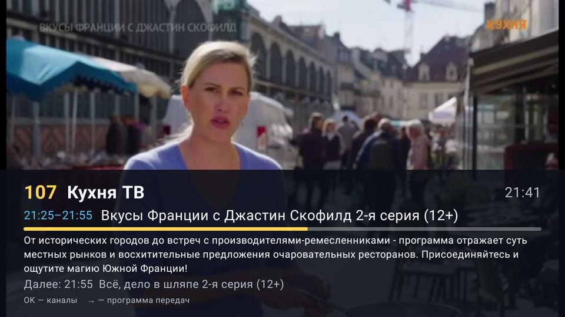
  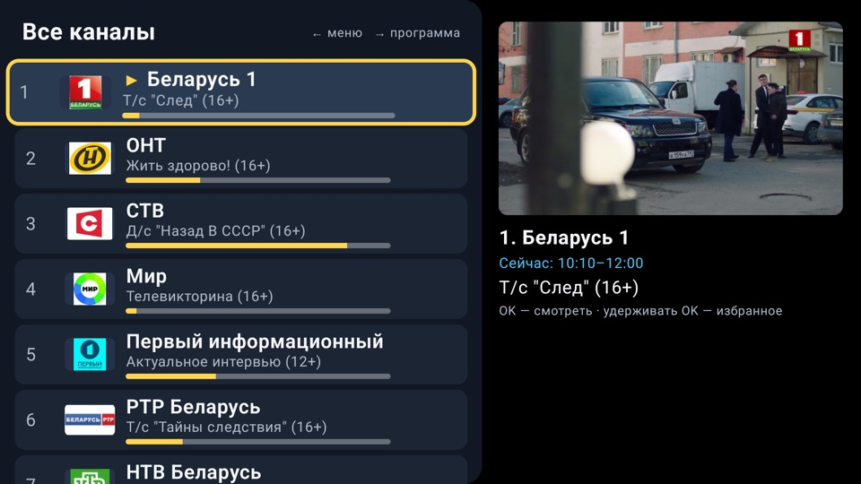
  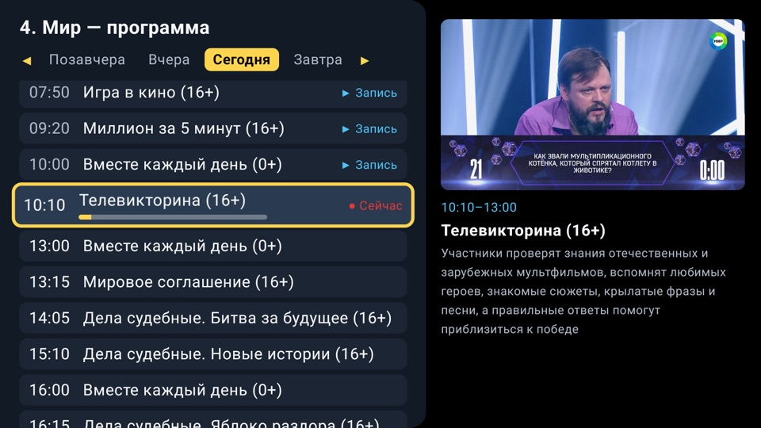
  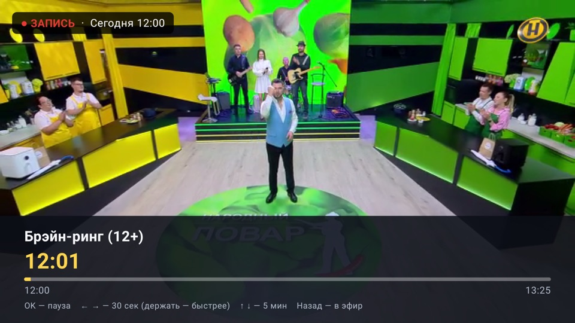
</p>

## О приложении

SMART ZALA — интернет-телевидение Белтелекома. Официальное приложение для приставок («ZALA yasna»)
нередко тормозит, показывает технические ошибки и неудобно управляется с пульта. Remotely — более простой
клиент для того же сервиса. Он создавался для пожилых зрителей, но подходит всем.

- **Как обычный телевизор.** После запуска сразу идёт канал, который смотрели в прошлый раз; ↑ и ↓ переключают каналы.
- **Описание передачи** по кнопке OK.
- **Избранное и категории.** Свой короткий список каналов или категории Белтелекома: «Кино», «Спорт», «Детские» и другие.
- **Программа передач** с позавчера по завтра, с описаниями.
- **Архив за 2 дня.** Прошедшую передачу можно посмотреть, а идущую — начать сначала.
- **Устойчивость.** При пропаже интернета или зависании картинки приложение восстанавливает показ само.
- **Крупный шрифт** трёх размеров.
- **Автозапуск** при включении приставки.
- **Мышь** поддерживается наравне с пультом.

> [!IMPORTANT]
> Приложение не даёт бесплатного телевидения. Нужна оплаченная услуга SMART ZALA и логин с паролем от неё.

## Требования

| | |
|---|---|
| Устройство | Телевизор или приставка с Android TV / Google TV, Android 7 или новее |
| Услуга | Оплаченная SMART ZALA: «Канапа ТВ», «ЯСНА … SMART», «Семейный» и другие тарифы ([beltelecom.by](https://beltelecom.by/private/tv/smart)) |
| Учётная запись | Логин и пароль SMART ZALA — те же, что для официального приложения «ZALA yasna» |
| Интернет | От 1 Мбит/с |

**Проверка логина.** Откройте на компьютере [tv.zala.by](https://tv.zala.by) и войдите. Если вход удался,
Remotely тоже будет работать. Логины от приложения «ZALA» (для Windows) относятся к другой платформе и не подходят.

> [!NOTE]
> Приложение проверено на Xiaomi Mi TV (Android TV 14); по отзывам работает на приставках ZALA DV9135 и Ugoos.
> На других устройствах с Android TV оно, скорее всего, тоже заработает — сообщите в [Issues](../../issues), если пробовали.
> Телевизоры Samsung (Tizen), LG (webOS) и iPhone не поддерживаются. На телефонах с Android приложение
> запускается, но рассчитано на телевизор.

## Установка

Приложения нет в Google Play, его устанавливают из файла. Это делается один раз и занимает 10–15 минут.

Файл — **`Remotely.apk`**. Ссылка всегда ведёт на последнюю версию:
https://github.com/satroschenko/remotely/releases/latest/download/Remotely.apk.
Тот же файл с номером версии в имени лежит на странице [последней версии](../../releases/latest), в разделе *Assets*.

### 1. Разрешите установку из файлов

1. Откройте на приставке **Настройки**.
2. Найдите пункт **Неизвестные источники**. На Xiaomi:
   **Настройки → Настройки устройства** (или **Приложения**) **→ Безопасность и ограничения → Неизвестные источники**.
3. Разрешите установку приложению, через которое будете ставить файл (*Send Files to TV* или *X-plore*).

Разрешение можно выдать и позже: если во время установки приставка спросит «Разрешить установку?», ответьте **Да**.

### 2. Перенесите файл и установите

<details open>
<summary><b>С телефона</b> — проще всего</summary>

<br>

1. Установите бесплатное приложение **Send Files to TV** на телефон (Google Play или App Store) и на приставку (Google Play на приставке).
2. На телефоне скачайте `Remotely.apk` со страницы [последней версии](../../releases/latest).
3. На приставке откройте *Send Files to TV* и выберите **Receive**.
4. На телефоне откройте *Send Files to TV* → **Send** → выберите файл → выберите приставку.
5. На приставке файл появится в папке *Download*: выберите его и нажмите **Установить**.

Телефон и приставка должны быть в одной сети Wi-Fi.

</details>

<details>
<summary><b>С флешки</b></summary>

<br>

1. На компьютере скачайте `Remotely.apk` со страницы [последней версии](../../releases/latest) и скопируйте на флешку.
2. Вставьте флешку в приставку.
3. Установите на приставке **X-plore File Manager** (бесплатно, Google Play).
4. В X-plore откройте флешку, выберите `Remotely.apk` и нажмите **Установить**.

</details>

<details>
<summary><b>С компьютера через adb</b></summary>

<br>

1. На приставке: **Настройки → Настройки устройства → Об устройстве → «Сборка»**, нажмите 7 раз.
   Затем в разделе **Для разработчиков** включите **Отладку по USB / по сети**.
2. Узнайте IP-адрес приставки: **Настройки → Сеть**.
3. На компьютере:
   ```bash
   adb connect 192.168.1.50:5555          # IP приставки; на приставке нажмите «Разрешить»
   adb install -r Remotely.apk
   adb shell appops set app.remotely SYSTEM_ALERT_WINDOW allow   # для автозапуска на Google TV
   ```

</details>

### 3. Первый запуск

1. Откройте **Remotely** в списке приложений. Иконку удобно добавить в «Избранное» на главном экране.
2. Введите логин и пароль SMART ZALA и нажмите **Войти**. Больше вводить их не придётся.

<p align="center">
  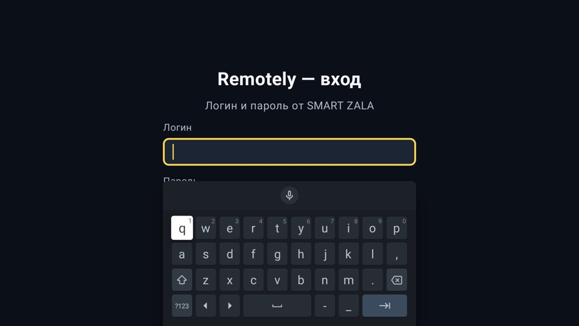
</p>

### 4. Настройки

Меню открывается кнопкой **←** из списка каналов. В пункте **⚙ Настройки**:

- **Запускать при включении приставки** — телевизор сразу будет показывать каналы.
  Если появится запрос «Поверх других приложений», разрешите его для Remotely.
- **Размер шрифта** — «Средний», «Крупный» (по умолчанию) или «Очень крупный».
- **Каналы** — скрыть ненужные, добавить в избранное, расставить в своём порядке.
  Номера каналов идут по вашему порядку.
- **Субтитры (где есть)** — показывать субтитры на каналах, где Zala их передаёт.

<p align="center">
  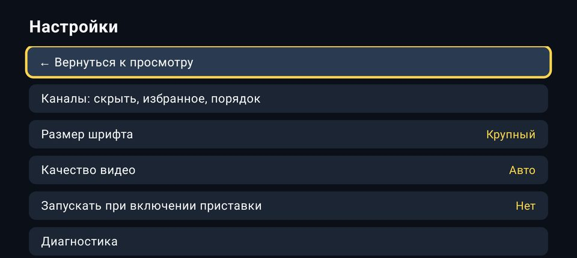
</p>

### Обновление

Приложение само проверяет обновления при запуске и раз в сутки. Когда выходит новая версия, ненадолго появляется подсказка, а в меню у пункта «Настройки» — пометка «есть обновление». Откройте **Настройки → Обновления → Обновить до версии…**: приложение скачает её и откроет стандартное окно установки Android, установка — только после вашего подтверждения. В первый раз Android попросит разрешить Remotely устанавливать приложения. Под кнопкой коротко написано, что нового в этой версии. Там же можно проверить обновления вручную или выключить автоматическую проверку.

Можно и по-старому: установить новую версию поверх старой тем же способом. Логин, избранное и настройки сохранятся.

## Управление

Всё управление — стрелки, **OK** и **Назад**. Кнопка **Назад** никогда не закрывает приложение:
она ведёт по кругу «просмотр → список каналов → меню → просмотр».
Выйти можно только через пункт меню **✕ Выход**.

### Просмотр канала

| Кнопка | Действие |
|---|---|
| **↑ / ↓** | следующий / предыдущий канал |
| **OK** | название и описание текущей передачи; повторное нажатие — список каналов |
| **←** | список каналов |
| **→** | программа передач канала |
| **Назад** | скрыть описание или открыть список каналов |

### Список каналов

Задержитесь на канале на секунду — он появится в окне предпросмотра, а под ним будет видно, что идёт сейчас и далее.

| Кнопка | Действие |
|---|---|
| **OK** | смотреть канал |
| **Удерживать OK** | добавить в избранное или убрать из него |
| **←** | меню |
| **→** | программа передач канала |

Список закольцован: после последнего канала идёт первый.

### Меню, избранное и категории

| Пункт | Что показывает |
|---|---|
| **Все каналы** | полный список |
| **★ Избранное** | только отмеченные каналы |
| **☰ Категории** | категории Белтелекома; выбранная подписана под пунктом |
| **⚙ Настройки** | настройки приложения |
| **✕ Выход** | закрыть приложение |

В избранном и в категории кнопки ↑ / ↓ переключают только их каналы. Список категорий приходит
от Белтелекома и обновляется автоматически. Текущий выбор отмечен значком ▶.

<p align="center">
  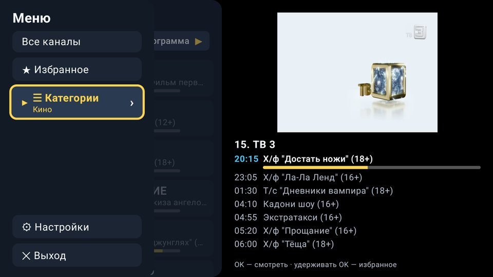
  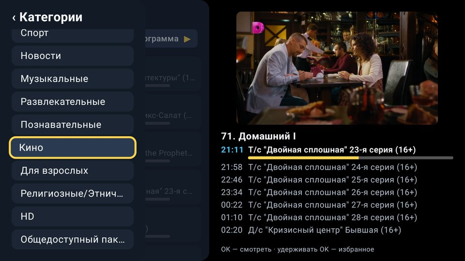
</p>

<p align="center">
  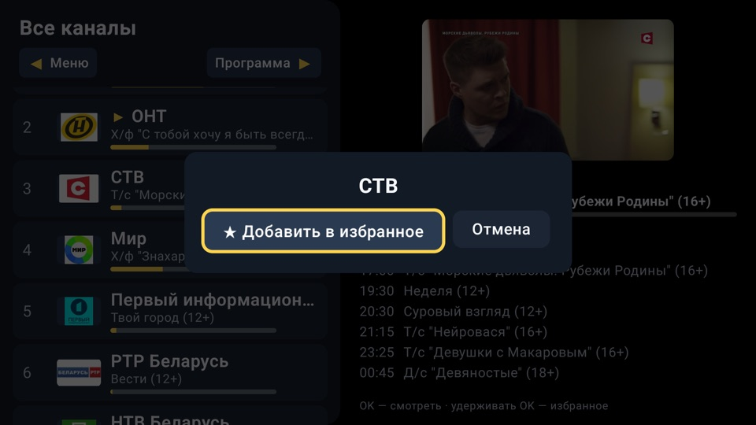
  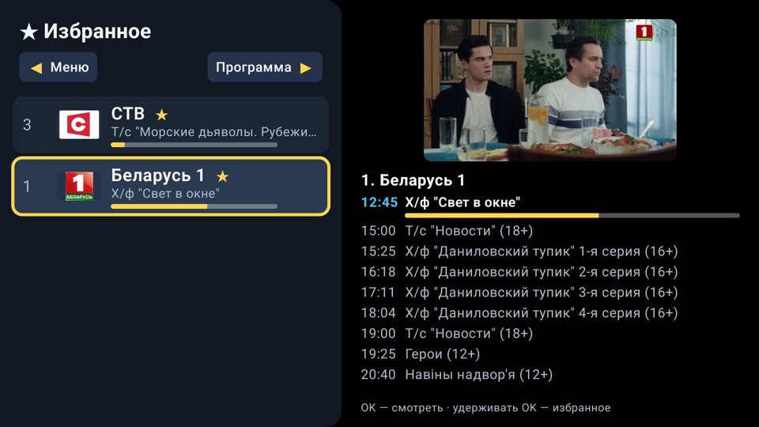
</p>

### Архив

1. На канале нажмите **→** — откроется программа передач.
2. Выберите день и передачу с пометкой **▶ Архив**, нажмите **OK**.
3. Передачу, которая идёт сейчас, можно начать сначала: выберите её и **⟲ С начала**.

| Кнопка | Действие |
|---|---|
| **OK** | пауза / продолжить |
| **← / →** | на 30 секунд назад / вперёд (удержание — быстрее) |
| **↑ / ↓** | на 5 минут вперёд / назад |
| **Назад** | вернуться в прямой эфир |

<p align="center">
  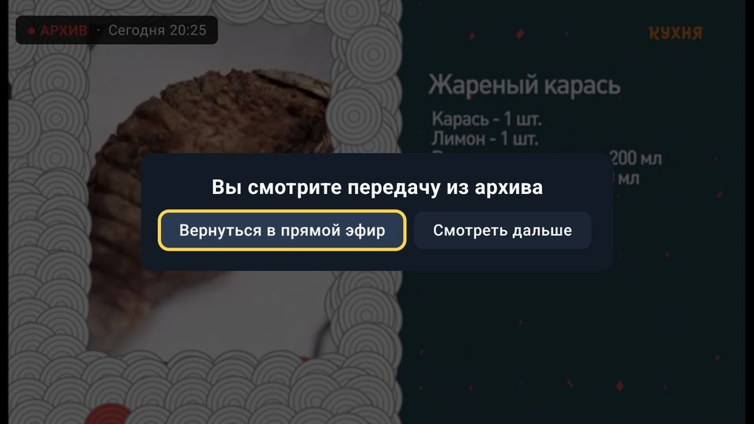
</p>

### Мышь

| Действие | Результат |
|---|---|
| Клик по видео | как OK; в архиве — пауза |
| Колёсико | переключение каналов; в архиве — перемотка |
| Клик по каналу, передаче, дню, пункту меню | выбор |
| Правая кнопка | как **Назад** |

## Решение проблем

| На экране | Что делать |
|---|---|
| «Нет интернета, ждём…» | Проверьте роутер и кабель. Приложение подключится само, когда интернет появится |
| «Не удаётся подключиться к Zala» | Нажмите **Повторить** |
| «Неверный логин или пароль» | Проверьте данные SMART ZALA. Если пароль менялся: *Настройки → Выйти из аккаунта* и войдите заново |
| Картинка застыла | Подождите несколько секунд — показ перезапустится сам |
| Экран гаснет через несколько часов | Так приставка экономит энергию; время задаётся в её настройках |
| Файл не устанавливается | Проверьте шаг 1. Если новая версия не встаёт поверх старой, удалите старую и установите заново |
| Что-то другое | *Настройки → Диагностика*: сфотографируйте экран и [напишите в Issues](../../issues) |

## Конфиденциальность

- Логин и пароль хранятся только на приставке, в зашифрованном виде.
- Приложение обращается только к серверам Белтелекома (`tv.zala.by`). Рекламы и сбора данных нет.
- Исходный код открыт.

## Обратная связь

Ошибки и предложения — в [Issues](../../issues). Укажите, что произошло и на каком устройстве; фото экрана очень помогает.

<details>
<summary><b>Для разработчиков</b></summary>

<br>

Kotlin 2.3, Compose for TV, Media3 ExoPlayer (DASH), OkHttp, DataStore. Android 7+ (minSdk 24, core library desugaring for java.time).

Официальное приложение — WebView-обёртка ZTE над порталом `tv.zala.by`. Remotely обращается к тому же
порталу напрямую: вход в 4 шага, JSON-эндпоинты каналов, категорий и программы, DASH-потоки без DRM (эфир и архив).
Описание API и решения — в [спецификации](docs/superpowers/specs/2026-10-15-zala-tv-design.md).

```
ui (Compose for TV) ─► ViewModel ─► репозитории ─► SessionManager ─► ZalaApi (OkHttp)
                            │
                            └─► PlayerController ─► ExoEngine (Media3, один плеер на всё)
```

| Модуль | Что делает |
|---|---|
| `data/api` | HTTP-вызовы портала и разбор ответов |
| `data/session` | Тихий вход, обновление токена, повторный вход при потере сессии, heartbeat |
| `data/repo` | Каналы (подписка, категории, избранное, порядок, кэш), программа передач, ссылки на потоки |
| `data/store` | Настройки (DataStore) и логин/пароль, зашифрованные ключом Android Keystore (AES-GCM) |
| `data/update` | Проверка новой версии на GitHub, загрузка APK и передача системному установщику |
| `player` | Контроллер плеера: сторож зависаний, политика повторов, «лента» архива, перемотка |
| `ui` | Экраны: просмотр со слоями, вход, настройки, диагностика |

Сборка (нужны JDK 21 и Android SDK 35):

```bash
tools/gw.sh :app:testDebugUnitTest   # юнит-тесты
tools/gw.sh :app:assembleDebug       # отладочная сборка
tools/make-keystore.sh               # один раз: свой ключ подписи (не попадает в git)
tools/gw.sh :app:assembleRelease     # подписанный APK
tools/install.sh <IP приставки>      # сборка + установка по сети через adb
python3 -I tools/smoke.py            # живая проверка API Zala (нужен .env с login/pass)
```

APK со своим ключом не встанет поверх версии из Releases — сначала удалите старую.

В репозиторий не попадают: `.env`, `release.jks`, `keystore.properties`, HAR-дампы, декомпилированный оригинал.

</details>

---

Лицензия [MIT](LICENSE).

<sub>Remotely — некоммерческий проект. Это неофициальное приложение, оно не связано с РУП «Белтелеком»
и не одобрено им. ZALA и SMART ZALA — товарные знаки их владельцев и упоминаются только для того, чтобы объяснить,
с какой услугой работает приложение. Названия и логотипы каналов принадлежат их владельцам.</sub>
