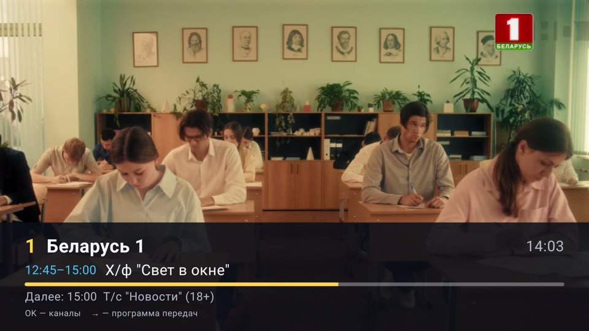

<div align="center">

# 📺 Remotely

**Неофициальное удобное приложение для просмотра SMART ZALA на телевизоре или приставке с Android TV**

Включили телевизор — сразу идёт любимый канал. Крупные буквы, простое управление с пульта,
никаких непонятных ошибок на экране. Делалось для родителей и бабушек с дедушками, но удобно всем.

### [⬇️ Скачать последнюю версию](../../releases/latest)

</div>

<p align="center">
  
  
  
  
</p>

---

## 🤔 Что это и зачем

**SMART ZALA** — это интернет-телевидение от Белтелекома. У него есть своё приложение для приставок
(«ZALA yasna»), но оно часто тормозит, показывает технические ошибки и неудобно управляется с пульта —
особенно для пожилых людей.

**Remotely** — это другое, более простое приложение для того же самого телевидения:

- 📺 **Работает как обычный телевизор.** Запустили — показывает канал, который смотрели в прошлый раз.
  Кнопки ↑ и ↓ на пульте переключают каналы.
- 🔤 **Крупный шрифт**, который можно сделать ещё крупнее.
- ⭐ **Избранное.** Можно оставить только любимые каналы, чтобы не листать весь список.
- 📅 **Программа передач** с позавчера по завтра — с описаниями.
- ⏪ **Записи за последние 2 дня.** Пропустили передачу — можно посмотреть её позже.
  А если передача уже идёт — можно начать её **с самого начала**.
- 🛡 **Не «ломается».** Если пропал интернет или картинка зависла, приложение само всё восстановит.
  Вместо непонятных ошибок — одна большая кнопка «Повторить».
- 🔌 **Может запускаться само** при включении приставки.

> [!IMPORTANT]
> Приложение **не даёт бесплатного телевидения**. Нужна **оплаченная услуга SMART ZALA**
> от Белтелекома и логин с паролем от неё. Remotely — только другой «телевизор» для тех же каналов.

## ✅ Что понадобится

| | |
|---|---|
| 📺 **Телевизор или приставка с Android TV / Google TV** | Android 9 или новее |
| 💳 **Оплаченная услуга SMART ZALA** | Тарифы «Канапа ТВ», «ЯСНА … SMART», «Семейный» и др. Подробнее — на [beltelecom.by](https://beltelecom.by/private/tv/smart) |
| 🔑 **Логин и пароль SMART ZALA** | Выдают в офисе Белтелекома или в личном кабинете. Это те же логин и пароль, с которыми вы входите в официальное приложение «ZALA yasna» |
| 🌐 **Интернет** | Любой, от 1 Мбит/с |

**Как проверить, подойдёт ли ваш логин:** откройте на компьютере [tv.zala.by](https://tv.zala.by)
и войдите. Получилось — Remotely тоже будет работать.

> [!WARNING]
> **Приложение проверено только на приставках и телевизорах Xiaomi Mi** (Android TV 14).
> По отзывам пользователей работает и на приставках **ZALA DV9135** от Белтелекома и **Ugoos**.
> На других устройствах с Android TV (Sony, Philips, TCL, Chromecast и т. д.) оно, скорее всего,
> тоже заработает, но это **не проверялось**. Если попробуете — расскажите в [Issues](../../issues),
> получилось или нет.
>
> На телефонах, планшетах, iPhone, телевизорах Samsung (Tizen) и LG (webOS) приложение **не работает**.

## 📥 Как установить

Приложения нет в Google Play, поэтому его устанавливают из файла. Это делается **один раз**
и займёт 10–15 минут. Если вы не уверены в своих силах, попросите помочь детей или внуков:
дальше пользоваться будет просто.

Файл для установки называется **`Remotely-x.y.apk`** (x.y — номер версии, например `Remotely-1.5.apk`).
Его можно скачать на странице [последней версии](../../releases/latest), в разделе *Assets* внизу страницы.

### Шаг 1. Разрешите установку на приставке (один раз)

Android по умолчанию не даёт ставить приложения не из Google Play. Это нужно разрешить:

1. Откройте на приставке **Настройки**.
2. Найдите пункт **Неизвестные источники**. На Xiaomi он находится здесь:
   **Настройки → Настройки устройства** (или **Приложения**) **→ Безопасность и ограничения → Неизвестные источники**.
3. Включите разрешение для приложения, через которое будете устанавливать
   (*Send Files to TV* или *X-plore*, см. ниже).

> Это разрешение можно включить уже после того, как вы поставите *Send Files to TV* или *X-plore*.
> Если приставка спросит «Разрешить установку?» во время установки, просто ответьте **Да**.

### Шаг 2. Перенесите файл на приставку и установите

Выберите любой удобный способ.

<details open>
<summary><b>Способ А. С телефона — проще всего</b></summary>

<br>

1. Установите бесплатное приложение **Send Files to TV**:
   - на **телефон**: из Google Play или App Store;
   - на **приставку**: из Google Play на приставке (в поиске наберите «Send files to TV»).
2. На **телефоне** откройте страницу [последней версии](../../releases/latest) и скачайте файл `Remotely-x.y.apk`.
3. На **приставке** откройте *Send Files to TV* и выберите **Receive** (получить).
4. На **телефоне** откройте *Send Files to TV* → **Send** (отправить) → выберите скачанный файл → выберите свою приставку.
5. На **приставке** файл появится в папке *Download*. Выберите его в *Send Files to TV* и нажмите **Установить**.

> Телефон и приставка должны быть подключены к одному и тому же Wi-Fi.

</details>

<details>
<summary><b>Способ Б. С флешки</b></summary>

<br>

1. На компьютере скачайте файл `Remotely-x.y.apk` со страницы [последней версии](../../releases/latest)
   и скопируйте его на USB-флешку.
2. Вставьте флешку в приставку.
3. Установите на приставке файловый менеджер **X-plore File Manager** (бесплатно, из Google Play на приставке).
4. В X-plore откройте флешку, выберите `Remotely-x.y.apk` и нажмите **Установить**.

</details>

<details>
<summary><b>Способ В. С компьютера через adb (для продвинутых)</b></summary>

<br>

1. На приставке: **Настройки → Настройки устройства → Об устройстве → «Сборка»**, нажмите 7 раз
   (появится «Вы стали разработчиком»). Затем в **Для разработчиков** включите **Отладку по USB / по сети**.
2. Узнайте IP-адрес приставки: **Настройки → Сеть**.
3. На компьютере:
   ```bash
   adb connect 192.168.1.50:5555          # IP приставки; на приставке нажмите «Разрешить»
   adb install -r Remotely-x.y.apk
   adb shell appops set app.remotely SYSTEM_ALERT_WINDOW allow   # для автозапуска на Google TV
   ```

</details>

### Шаг 3. Первый запуск

1. Найдите **Remotely** в списке приложений на приставке и откройте его.
   Иконку можно перетащить в «Избранное» на главном экране, чтобы потом не искать.
2. Введите **логин и пароль SMART ZALA** с пульта и нажмите **Войти**. Больше вводить их не придётся.
3. Готово, начнётся показ первого канала.

<p align="center">
  
</p>

### Шаг 4. Настройте под себя (по желанию)

Нажмите **OK**, затем **←**, в меню выберите **⚙ Настройки**:

- **Запускать при включении приставки → Да**: тогда телевизор сразу будет показывать каналы.
  Если появится экран разрешения «Поверх других приложений», разрешите его для Remotely.
- **Размер шрифта**: если буквы мелковаты, выберите «Очень крупный».
- **Каналы**: скрыть ненужные и расставить каналы в удобном порядке.
  Нажмите **OK** на канале и выберите, что сделать: *В избранное*, *Скрыть* или *Переместить*.
  Чтобы переместить канал, выберите *Переместить*, двигайте его стрелками **↑ / ↓**,
  а когда он встанет на нужное место, нажмите **OK**.
  Номера каналов идут по вашему порядку: канал, поставленный первым, получает номер 1.

<p align="center">
  
</p>

### Как обновить приложение

Скачайте новую версию и установите её **поверх старой** тем же способом. Удалять старую не нужно:
логин, избранное и настройки сохранятся.

## 🎮 Как пользоваться

Всё управление идёт стрелками, кнопкой **OK** и кнопкой **Назад** на пульте.

### Когда смотрите канал

| Кнопка | Что происходит |
|---|---|
| **↑ / ↓** | следующий / предыдущий канал |
| **OK** или **←** | открыть список каналов |
| **→** | открыть программу передач этого канала |
| **Назад** | открыть список каналов |

### В списке каналов

Задержитесь на канале на секунду: он начнёт показываться в окошке справа, а под ним будет видно,
что идёт сейчас и что будет дальше.

| Кнопка | Что происходит |
|---|---|
| **OK** | смотреть этот канал |
| **удерживать OK** | добавить канал в ⭐ избранное (или убрать из него) |
| **←** | меню: все каналы, избранное, настройки |
| **→** | программа передач канала |
| **Назад** | открыть меню |

Список закольцован: после последнего канала снова идёт первый, а с первого кнопкой ↑ можно сразу
перейти к последнему.

### Как выйти из приложения

Нажимайте **Назад**: просмотр → список каналов → меню → вопрос «Выйти из приложения?».
Выберите **Выйти**. Случайно закрыть приложение одним нажатием не получится.

<p align="center">
  
  
</p>

### Избранные каналы

Удерживайте **OK** на канале и выберите **★ Добавить в избранное**. Потом в меню (**←**) выберите
**★ Избранное**: в списке останутся только ваши каналы, и кнопки ↑ / ↓ будут переключать только их.

<p align="center">
  
</p>

### Как посмотреть прошедшую передачу

1. На канале нажмите **→**, откроется программа передач.
2. Стрелками выберите день и передачу с пометкой **► Запись**, нажмите **OK**.
3. Чтобы посмотреть с начала то, что идёт сейчас, выберите **⟲ С начала**.

### Когда смотрите запись

| Кнопка | Что происходит |
|---|---|
| **OK** | пауза / продолжить |
| **← / →** | назад / вперёд на 30 секунд (если держать — быстрее) |
| **↑ / ↓** | вперёд / назад на 5 минут |
| **Назад** | вернуться в прямой эфир |

<p align="center">
  
</p>

## ❓ Если что-то не так

| Что на экране | Что делать |
|---|---|
| «Нет интернета, ждём…» | Проверьте интернет (роутер, кабель). Приложение подключится само, как только интернет появится |
| «Не удаётся подключиться к Zala» | Нажмите **OK** на кнопке «Повторить» |
| «Неверный логин или пароль» | Проверьте логин и пароль SMART ZALA. Если пароль меняли: *Настройки → Выйти из аккаунта*, затем войдите заново |
| Картинка застыла | Подождите несколько секунд, приложение само перезапустит показ |
| Экран погас через несколько часов | Это не приложение: так приставка экономит энергию. Время меняется в настройках самой приставки |
| Приставка не даёт установить файл | Проверьте Шаг 1 (Неизвестные источники). Если ставите новую версию поверх старой и выходит ошибка, удалите старую и установите заново |
| Что-то совсем странное | *Настройки → Диагностика*: сфотографируйте экран и [напишите нам](../../issues) |

## 🔒 Безопасность

- Логин и пароль хранятся **только на вашей приставке**, в зашифрованном виде.
- Приложение общается **только с серверами Белтелекома** (`tv.zala.by`), как и официальное. Никакой рекламы,
  слежки и сбора данных.
- Исходный код открыт, его может проверить любой.

## 💬 Вопросы и пожелания

Нашли ошибку или есть идея? Создайте запись в разделе [Issues](../../issues): опишите, что произошло,
на каком устройстве, и по возможности приложите фото экрана.

---

<details>
<summary><b>🛠 Для разработчиков</b></summary>

<br>

Kotlin 2.3, Compose for TV, Media3 ExoPlayer (DASH), OkHttp, DataStore. Android 9+ (minSdk 28).

Официальное приложение — WebView-обёртка ZTE над порталом `tv.zala.by`. Remotely обращается к тому же
порталу напрямую: вход в 4 шага, JSON-эндпоинты каналов и программы, DASH-потоки без DRM (эфир и записи).
Описание API и решения — в [спецификации](docs/superpowers/specs/2026-10-15-zala-tv-design.md).

```
ui (Compose for TV) ─► ViewModel ─► репозитории ─► SessionManager ─► ZalaApi (OkHttp)
                            │
                            └─► PlayerController ─► ExoEngine (Media3, один плеер на всё)
```

| Модуль | Что делает |
|---|---|
| `data/api` | HTTP-вызовы портала и разбор ответов |
| `data/session` | Тихий вход, обновление токена, повторный вход при потере сессии, heartbeat |
| `data/repo` | Каналы (подписка, избранное, порядок, кэш), программа передач, ссылки на потоки |
| `data/store` | Настройки (DataStore) и логин/пароль, зашифрованные ключом Android Keystore (AES-GCM) |
| `player` | Контроллер плеера: сторож зависаний, политика повторов, «лента» архива, перемотка |
| `ui` | Экраны: просмотр со слоями, вход, настройки, диагностика |

Сборка (нужны JDK 21 и Android SDK 35):

```bash
tools/gw.sh :app:testDebugUnitTest   # юнит-тесты
tools/gw.sh :app:assembleDebug       # отладочная сборка
tools/make-keystore.sh               # один раз: свой ключ подписи (не попадает в git)
tools/gw.sh :app:assembleRelease     # подписанный APK
tools/install.sh <IP приставки>      # сборка + установка по сети через adb
python3 -I tools/smoke.py            # живая проверка API Zala (нужен .env с login/pass)
```

APK, собранный со своим ключом, не встанет поверх версии из Releases: сначала удалите старую.

В репозиторий не попадают: `.env`, `release.jks`, `keystore.properties`, HAR-дампы, декомпилированный оригинал.

</details>

<sub>Remotely — некоммерческий проект энтузиаста. Это неофициальное приложение, оно не связано с РУП «Белтелеком»
и не одобрено им. ZALA и SMART ZALA — товарные знаки их владельцев и упоминаются только для того, чтобы объяснить,
с какой услугой работает приложение. Названия и логотипы каналов принадлежат их владельцам.</sub>
